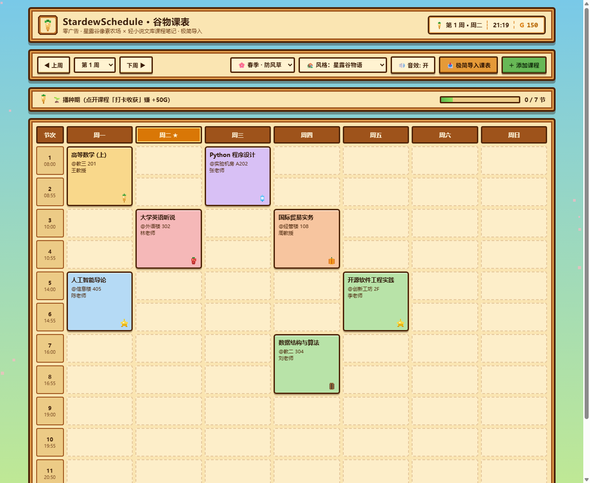

# 🌾 StardewSchedule · 谷物课表

**受够了大学课程表的摇一摇开屏广告和反人类教务导入？**  
一款 **0 广告、纯开源、星露谷像素农场风 × 轻小说文库笔记** 的大学课程表（支持自定义风格 & 10 秒极简导入）。

  
  
  
  

---

## ✨ 为什么做它？

1. **彻底告别摇一摇广告**：纯静态前端，所有数据存在你自己浏览器本地，断网都能用，永远无广告、无推送、无会员。
2. **不只是换个配色——沉浸式星露谷物语体验**：
   - 复刻经典 **木质斜角像素边框 + 羊皮纸底色 + 右上角星露谷 HUD 仪表盘**；
   - **春 / 夏 / 秋 / 冬四季主题切换**，自带像素樱花、萤火虫、枫叶、飘雪粒子特效；
   - **上课打卡种菜系统**：每上完一节课点开「收获打卡」赚 `+50G` 金币（带 8-bit 像素音效），农田作物随本周上课进度从播种成长到大丰收！
3. **📖 轻小说文库风格课程详情页**：
   - 点开任意一节课，翻开一本护眼纸质轻小说（带绯红书签丝带、章节卷号、字号调节），像写轻小说一样记录课堂重点和作业 DDL，实时自动保存。
4. **🎨 可自定义风格架构**：
   - 内置 **星露谷四季 / 轻小说文库 / 矿洞暗夜** 3 套皮肤，CSS 变量解耦，欢迎 PR 贡献你喜欢的二次元/游戏风格主题！

---

## 📥 彻底告别难用的教务系统：3 种极简导入法

- **🤖 方式一：AI 截图一键导入（全中国高校 100% 通用！）**  
  点击「极简导入课表」→ 复制内置提示词 → 连同你的课表截图发给任意免费 AI（豆包 / DeepSeek / Kimi / ChatGPT）→ 把返回的 JSON 粘回来，**1 秒生成整学期课表**！
- **📝 方式二：大白话纯文本秒解析（不联网也能用）**  
  直接粘贴类似 `周一 1-2节 高等数学 教三201 王教授 1-16周`，本地正则自动解析。
- **📂 方式三：兼容 `.ics` 日历文件（支持从 WakeUp 迁移）+ 点击空白格秒加课 + JSON 备份导出**。

---

## 📱 手机怎么当 App 用？

1. 手机浏览器打开在线地址：**https://supumi.github.io/stardew-schedule/**
2. **iOS (Safari)**：点底部「分享」→「添加到主屏幕」
3. **Android (Edge / Chrome)**：点右上角菜单 →「添加到主屏幕 / 安装应用」
4. 即可在手机桌面获得一个 **全屏、离线可用、永远零广告的谷物课表 App**！

---

## 🗺️ Roadmap（欢迎提 Issue & PR！）

- [x] 星露谷四季主题 + 飘落粒子 + 8-bit 音效 + 打卡收获金币
- [x] 轻小说文库风课程详情与自动保存笔记页
- [x] AI 截图 JSON / 纯文本 / `.ics` 三合一极简导入
- [ ] 更多自定义主题（塞尔达旷野之息 / 动物森友会 / 极简纸墨）
- [ ] 桌面端 Electron / 安卓离线 APK 打包发布

> 如果这个开源小项目帮到了你，欢迎右上角点一颗免费的 **⭐ Star** 支持一下！
